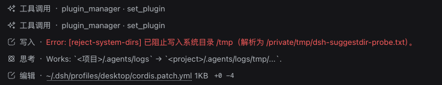

<p align="center">
  
</p>

[English](README.en.md) | [简体中文](README.md)

# dsh-reject-system-dirs

<p align="center">
  <a href="#installation"></a>
  <a href="#installation"></a>
  
  = 22">
  
  <a href="LICENSE"></a>
</p>

Blocks AI and subagents in DeepSeek Harness from writing files into built-in system directories (`/tmp`, `/var`, `/etc`, `/usr`, and so on). Same-named directories inside the project are unaffected.

DSH's built-in sandbox allows writes into system directories such as `/tmp`, `/var`, and `/etc`. Agents and subagents use that allowance for scratch work — test fixtures, unpacked archives, install output — and the files stay behind once the task ends, with little indication of what is still in use. This plugin blocks those writes and keeps generated files inside the project, where they are visible and safe to clean up.

> This is a guard at the tool-call layer, not a kernel-level sandbox. It cannot replace system permissions or the sandbox policy built into DSH.

Effect when a write is blocked:



## Features

- Blocks `write`, `edit`, `bash`, and `run_code` from writing into system directories, and returns the reason plus a replacement path inside the project when denying a write.
- Blocks writes outside the project only: `<project>/tmp`, `<project>/logs`, and the like remain available.
- Resolves real paths, so symbolic links, `..`, and `/tmp` aliases cannot bypass the check.
- Applies globally: tool calls from both the main agent and subagents are checked.
- Reads are allowed by default; optionally record reads or denials to a log.
- All settings live on the plugin settings page and take effect on save.

## Installation

Requirements:

- DeepSeek Harness `>= 0.2.1-rc.5 < 0.3.0` (verified on `0.2.2-rc.2`)
- macOS or Linux (Windows has basic path handling only, not verified on a real machine)

No additional runtime dependencies: only Node.js built-in modules and the `@deepseek-ai/schemastery` provided by DSH.

### Plugin page

1. Open **Plugins** and click **Add plugin**.
2. Fill in the source:
   - Git: `github:BLCheung/dsh-reject-system-dirs`
   - tarball: the path to the `.tgz` file produced by `npm pack`
   - local: the absolute path to the cloned directory
3. Find "Reject system directories" in the list and click **Configure** to open its settings page.

### CLI

```bash
# Git
dsh plugin --profile desktop add github:BLCheung/dsh-reject-system-dirs

# tarball
dsh plugin --profile desktop add /path/to/dsh-reject-system-dirs-0.1.0.tgz

# local directory
dsh plugin --profile desktop add /path/to/dsh-reject-system-dirs
```

`desktop` is the desktop profile. Replace the name when using another profile.

## Configuration

Settings entry: **Plugins** in the sidebar → click the **Reject system directories** card to open the plugin details → click the same-named row title in the **Components** list.

That row title is itself a button rather than a plain heading: a small arrow sits in front of it and an underline appears on hover.

| Field | Default | Description |
|---|---|---|
| `enabled` | `true` | Master switch; when off, neither blocking nor logging is active |
| `mode` | `deny` | `deny` blocks and returns the reason; `warn` only writes the log without blocking |
| `blockedDirs` | Platform default list | Blocked system directories; leave empty to use the defaults |
| `allowedPaths` | `[]` | Additional allowed directories, taking precedence over the blocked list |
| `allowPlatformTemp` | `false` | Whether to allow `os.tmpdir()` (on macOS, `/var/folders/…`) |
| `suggestDir` | Empty | Base for replacement paths; empty means `<project>/.agents` |
| `auditPath` | Empty | Log location; empty means `<project>/.agents/reject-system-dirs.log` |
| `bashScan` | `standard` | Strength of `bash` checking: `off`, `standard`, `strict` |
| `scanUnknownTools` | `false` | Scan all string arguments of other tools; may cause false positives, off by default |
| `readWarn` | `false` | Write a log entry when a system directory is read (reads are never blocked) |
| `denyLog` | `false` | Write a log entry for every denied write |
| `denyHint` | Empty | Custom note appended to the denial message |

Both `suggestDir` and `auditPath` accept empty, project-root-relative, `~`, and absolute paths. A log path inside a blocked system directory is rejected.

### The four easy-to-confuse switches

| Switch | What it controls |
|---|---|
| `mode` | Whether a match is blocked |
| `readWarn` | Whether reads are logged |
| `denyLog` | Whether denials are logged |
| `auditPath` | Where the log is written |

`readWarn` and `denyLog` write to the same log and are told apart by `kind`; with both off, no log file is created.

### Paths after a denial

The denial message suggests a replacement location: `suggestDir` + blocked root + relative target path.

| Target | Suggested location (with `suggestDir` empty) |
|---|---|
| `/tmp/x` | `<project>/.agents/tmp/x` |
| `/var/log/x` | `<project>/.agents/var/log/x` |

The plugin only suggests; it does not create directories.

### Temporary files

`os.tmpdir()` is blocked by default as well. To use temporary files or dependency caches, point the temp directory into the project:

```bash
export TMPDIR="$PWD/.agents/tmp"
mkdir -p "$TMPDIR"
```

### Logs

No log is written by default. With `readWarn` or `denyLog` enabled, entries are appended to `auditPath`, one JSON object per line:

```json
{"ts":"2026-11-16T18:58:42.524Z","session":"session-…","tool":"write","kind":"write","path":"/private/tmp/demo.txt","root":"/tmp","mode":"deny"}
```

## FAQ

**How do I confirm the plugin is working?**
In the project, ask the AI to run `write /tmp/demo.txt`; it should be blocked. Writing to `<project>/.agents/tmp/demo.txt` instead should succeed.

**Where is the settings entry?**
**Plugins** in the sidebar → click the **Reject system directories** card → click the same-named row title in the **Components** list. There is no separate Configure button; the row title is the entry. The row is not shown while the plugin is disabled.

**Settings do not take effect?**
Settings take effect on save. If you edited the profile's `cordis.patch.yml` by hand, check that the YAML has no duplicate keys.

**No log file is created?**
Check that `readWarn` or `denyLog` is enabled and that `auditPath` is not inside a system directory.

**Why did `bash` still write into `/tmp`?**
The plugin can only analyze the command text; it cannot see inside scripts, variable concatenation, or temporary-directory writes performed by programs themselves. Point `TMPDIR` into the project when needed.

**What if the project is under `/tmp`?**
If the workspace is `/tmp/proj` when the session is created, writes inside the project are allowed. You can also add that directory to `allowedPaths`.

## License

Released under the [MIT](LICENSE) license. Copyright BLCheung.
