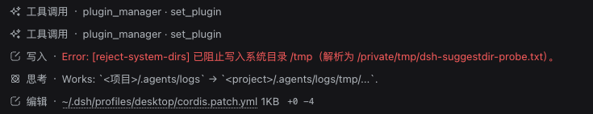

<p align="center">
  
</p>

# dsh-reject-system-dirs

<p align="center">
  <a href="#安装"></a>
  <a href="#安装"></a>
  
  = 22">
  
  <a href="LICENSE"></a>
</p>

阻止 DeepSeek Harness 中的 AI 与子 agent 往系统内置目录（`/tmp`、`/var`、`/etc`、`/usr` 等）写入文件，项目内的同名目录不受影响。

沙箱对 `/tmp` 和 `os.tmpdir()` 有意放行，有了这条缝，AI 和子 agent 就很难忍住不在系统目录里**拉屎💩**：跑个测试把 fixture 丢进 `/tmp`，解个压缩包在 `/var/tmp` 留下一堆文件，装点东西顺手往 `/usr/local` 里塞一把；完事拍拍屁股走人，一个字都不提。等你哪天清理系统盘，才发现满地都是无人认领的「遗产」——删了怕弄坏什么，不删又膈应。

这个插件在系统目录门口装了道门禁——**想拉，回自己项目里拉。** 项目里的同名目录（如 `<项目>/tmp`）照常可用。

> 这是工具调用层的防护插件，不是内核级沙箱，不能替代系统权限或 DSH 自带的沙箱策略。

被拦截时的效果：



## 功能

- 拦截 `write`、`edit`、`bash`、`run_code` 对系统目录的写入，拒绝时返回原因和项目内的替代路径。
- 只拦项目外的写入：`<项目>/tmp`、`<项目>/logs` 等照常可用。
- 按真实路径判断，符号链接、`..`、`/tmp` 别名不能绕过。
- 全局生效，主 agent 与子 agent 的工具调用都会被检查。
- 读取默认放行；可选把读取或拒绝记录写入日志。
- 所有配置都在插件设置页修改，保存即生效。

## 安装

环境要求：

- DeepSeek Harness `>= 0.2.1-rc.5 < 0.3.0`（在 `0.2.2-rc.2` 上验证）
- macOS 或 Linux（Windows 仅有基础路径处理，未实机验证）

无额外运行时依赖：仅使用 Node.js 内置模块与 DSH 提供的 `@deepseek-ai/schemastery`。

### 插件页

1. 打开 **Plugins**，点击 **Add plugin**。
2. 按来源填写：
   - Git：`github:BLCheung/dsh-reject-system-dirs`
   - tarball：`npm pack` 生成的 `.tgz` 文件路径
   - 本地：克隆后的目录绝对路径
3. 在列表中找到「系统目录写入拦截」，点击 **Configure** 打开设置页。

### 命令行

```bash
# Git
dsh plugin --profile desktop add github:BLCheung/dsh-reject-system-dirs

# tarball
dsh plugin --profile desktop add /path/to/dsh-reject-system-dirs-0.1.0.tgz

# 本地目录
dsh plugin --profile desktop add /path/to/dsh-reject-system-dirs
```

`desktop` 是桌面端 profile，使用其他 profile 时替换名称。

## 配置

设置入口：侧边栏 **Plugins** → 点击「系统目录写入拦截」卡片进入插件详情 → 在「组件」列表里点击同名的行标题。

这个行标题本身就是按钮，不是普通标题：前面有一个小箭头，鼠标悬停时会出现下划线。

| 字段 | 默认 | 说明 |
|---|---|---|
| `enabled` | `true` | 总开关，关闭后拦截和日志都不生效 |
| `mode` | `deny` | `deny` 拦截并返回原因；`warn` 只写日志、不拦截 |
| `blockedDirs` | 平台默认清单 | 被禁系统目录，留空使用默认值 |
| `allowedPaths` | `[]` | 额外放行的目录，优先于被禁清单 |
| `allowPlatformTemp` | `false` | 是否放行 `os.tmpdir()`（macOS 的 `/var/folders/…`） |
| `suggestDir` | 空 | 替代路径的基址，空表示 `<项目>/.agents` |
| `auditPath` | 空 | 日志位置，空表示 `<项目>/.agents/reject-system-dirs.log` |
| `bashScan` | `standard` | `bash` 检查强度：`off`、`standard`、`strict` |
| `scanUnknownTools` | `false` | 扫描其他工具的全部字符串参数，可能误伤，默认关闭 |
| `readWarn` | `false` | 读取系统目录时写日志（读取本身从不拦截） |
| `denyLog` | `false` | 每次拒绝写入时写日志 |
| `denyHint` | 空 | 追加在拒绝文案末尾的自定义说明 |

`suggestDir` 与 `auditPath` 都支持空、相对项目根、`~` 和绝对路径；落在被禁系统目录内的日志路径会被拒绝。

### 四个容易混淆的开关

| 开关 | 控制什么 |
|---|---|
| `mode` | 命中时拦不拦 |
| `readWarn` | 读取是否写日志 |
| `denyLog` | 拒绝是否写日志 |
| `auditPath` | 日志写到哪里 |

`readWarn` 和 `denyLog` 写的是同一份日志，用 `kind` 区分；两者都关闭时不生成日志文件。

### 拒绝后的路径

拒绝文案会给出替代位置：`suggestDir` + 被禁根 + 目标相对路径。

| 目标 | 建议位置（`suggestDir` 为空时） |
|---|---|
| `/tmp/x` | `<项目>/.agents/tmp/x` |
| `/var/log/x` | `<项目>/.agents/var/log/x` |

插件只给建议，不自动创建目录。

### 临时文件

`os.tmpdir()` 默认也被拦截。需要临时文件或依赖缓存时，把临时目录指到项目内：

```bash
export TMPDIR="$PWD/.agents/tmp"
mkdir -p "$TMPDIR"
```

### 日志

默认不写日志。打开 `readWarn` 或 `denyLog` 后，记录会追加到 `auditPath`，每行一条 JSON：

```json
{"ts":"2026-11-16T18:58:42.524Z","session":"session-…","tool":"write","kind":"write","path":"/private/tmp/demo.txt","root":"/tmp","mode":"deny"}
```

## 常见问题

**怎么确认插件生效？**
在项目里让 AI 执行 `write /tmp/demo.txt`，应被拒绝；改写到 `<项目>/.agents/tmp/demo.txt` 应成功。

**设置页的入口在哪？**
侧边栏 **Plugins** → 点击「系统目录写入拦截」卡片 → 在「组件」列表里点击同名的行标题。没有单独的 Configure 按钮，行标题就是入口；插件被停用时不会显示这一行。

**改了设置不生效？**
设置页保存即生效；如果手动改过 profile 的 `cordis.patch.yml`，确认 YAML 没有重复键。

**日志没有生成？**
确认 `readWarn` 或 `denyLog` 已打开，且 `auditPath` 不在系统目录内。

**为什么 `bash` 还是写进了 `/tmp`？**
插件只能分析命令文本，看不到脚本内部、变量拼接或程序自身的临时目录写入；需要时把 `TMPDIR` 指到项目内。

**项目就在 `/tmp` 下怎么办？**
会话创建时工作区在 `/tmp/proj` 的话，项目内写入会放行；也可以把该目录加入 `allowedPaths`。

## 许可证

本项目采用 [MIT](LICENSE) 许可证，版权归 BLCheung 所有。
